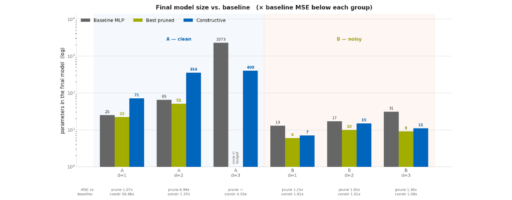
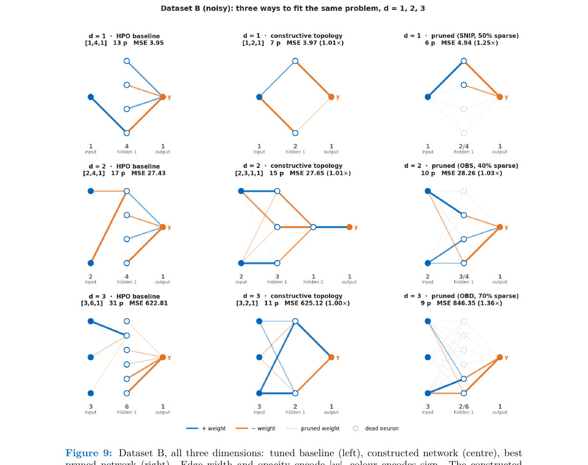
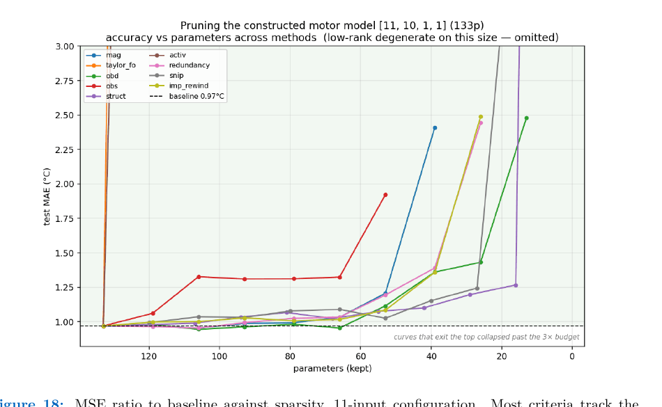
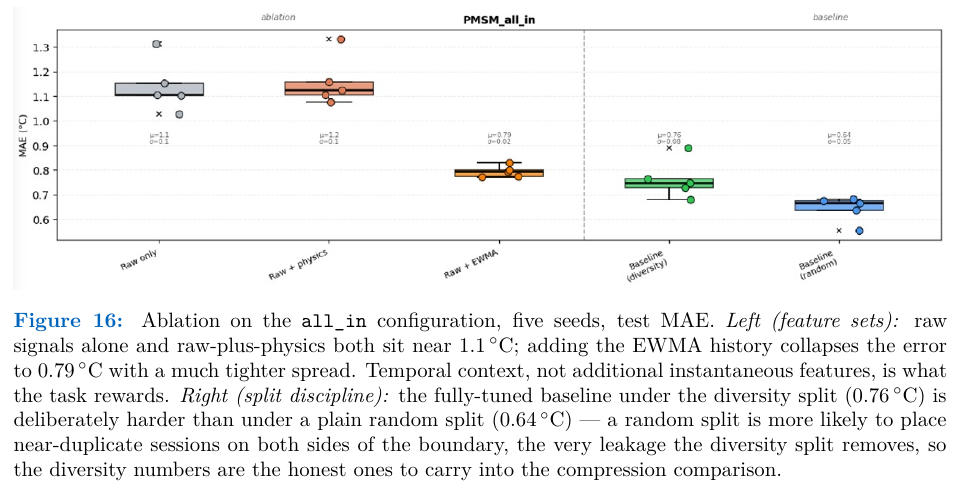
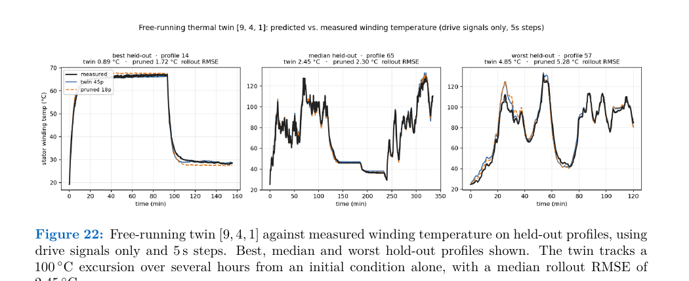

# How Lean Can We Go?
### Constructive Topology Search vs. Pruning for Compact Neural Networks

**Case study: Optimization of Artificial Neural Networks** · TUM Department of Mathematics × Schaeffler AG · Course CIT413058
Supervisors: PD Dr. T. Köppl, M.Sc. F. Holzberger

How small can a neural network be and still meet a target accuracy? We compare two opposite
strategies, **pruning** a large trained network and **growing** a small one from a single neuron
(constructive topology search), first on controlled synthetic regression problems and then on a
real industrial task: estimating the stator-winding temperature of a permanent-magnet
synchronous motor (PMSM) from signals the drive already measures.

[Report (PDF)](./docs/Paper/report.pdf) · [Poster (PDF)](./poster/poster.pdf) · [Reproducibility](./docs/REPRODUCIBILITY.md) · [Documentation index](./docs/README.md)

## Start here

| If you want to... | Go to |
|---|---|
| Understand the project in 5 minutes | this README, sections 1-6 |
| Read the full method, derivations and results | [`docs/Paper/report.pdf`](./docs/Paper/report.pdf) |
| See the poster | [`poster/poster.pdf`](./poster/poster.pdf) |
| Verify the code runs (about 5 s, no downloads) | `python tests/smoke_test.py` |
| Re-run the experiments, and know what is reproducible | [`docs/REPRODUCIBILITY.md`](./docs/REPRODUCIBILITY.md) |
| Browse the code | `src/` (pruning), `patenting/` (constructive search) |
| Browse raw results | [`results/`](./results/README.md) |

---
## 1. Motivation

PMSMs fail at the stator winding when it overheats, but a sensor there is expensive, fragile,
or mechanically impossible to route. The standard fix is a data-driven estimator that infers
winding temperature from signals the drive already measures (voltages, currents, speed,
torque, ambient/coolant temperature). That estimator runs on embedded hardware across
millions of units, so its parameter count is a direct, recurring hardware cost.

This raises a concrete question: **given a target accuracy, what is the smallest network that
reaches it, and which method finds that network most reliably?**

## 2. Project overview

We implement and compare two opposing routes to a compact network under one shared
evaluation protocol (identical splits, identical error budgets):

- **Pruning (subtractive):** train an over-parameterised network, score every weight or
  neuron by an importance criterion, remove the least important, fine-tune.
- **Adagos (constructive):** grow a network from a single-neuron seed, adding and removing
  structure only when a cheap saliency estimate says it is worth it, retraining with
  Gauss–Newton at every step. This is a faithful implementation of the topology-search method
  patented as **US 12,124,779 B2**.

Both routes are evaluated first on a controlled synthetic family (a known quadratic, clean vs.
noisy, input dimension 1–3) and then on the public
[Kaggle Electric Motor Temperature](https://www.kaggle.com/datasets/wkirgsn/electric-motor-temperature)
benchmark (Kirchgässner, Wallscheid & Böcker — 1.33M samples, 69 drive profiles). No
Schaeffler-internal data is used or included in this repository; Schaeffler's motivation is why
the real-motor task was chosen, and the public dataset stands in for their own motors.

## 3. Methods

### Pruning — 10 criteria under one shared interface
| Criterion | Granularity | Idea |
|---|---|---|
| Magnitude | weight | remove smallest `\|w\|` |
| Taylor-FO | weight | first-order loss-change estimate |
| Optimal Brain Damage (OBD) | weight | diagonal-Hessian saliency |
| Optimal Brain Surgeon (OBS) | weight | full-Hessian saliency + weight compensation |
| Structured | neuron | remove by L2-norm of outgoing weights |
| Activation | neuron | remove units with near-zero mean activation |
| Redundancy | neuron | remove near-duplicate units (cosine similarity) |
| SNIP | weight | single scoring pass at initialisation |
| IMP + Rewind | weight | iterative prune → rewind to init (Lottery Ticket style) |
| Low-rank | matrix | truncated SVD of a weight matrix |

Every criterion shares one pipeline (train → score → mask → recover with Adam + LBFGS polish
→ evaluate on a held-out split never used for selection), so differences in the comparison come
from the criterion, not the protocol.

### Adagos — constructive topology search
Candidates (`add_neuron`, `add_layer`, `add_skip`, `remove_neuron`, `remove_layer`) are ranked
by a Lagrange-multiplier saliency estimate that requires no retraining; only the winning
candidate is retrained, with a damped Gauss–Newton (Levenberg–Marquardt) step. Growth and
pruning alternate until nothing improves. See `patenting/` and §4 of the report for the full
derivation.

## 4. Experimental setup

- **Synthetic data:** `f(x) = (x-1)^T A (x-1)`, clean (Dataset A) and with 12.5% peak-to-peak
  Gaussian noise (Dataset B), at input dimension d ∈ {1, 2, 3}. Lets the two factors that are
  confounded in real data — noise and dimensionality — be varied independently.
- **PMSM (real motor):** profile-level train/val/test splits (never a random sample-level
  split, to avoid leaking near-duplicate consecutive readings), a greedy max-diversity training
  set, and three input configurations (`all_in`, `no_temps`, `no_temps_pm`) that drop sensors a
  production motor may not carry. A separate 81-dimensional feature set adds physics-derived
  terms and multi-scale EWMA histories on top of the 11 raw signals.
- **Two targets:** a *static* estimator (instantaneous signals → temperature) and a *dynamic
  thermal twin* (predicts a temperature increment, integrated forward in free-running mode with
  no sensor in the loop — a materially different task, since its own errors compound over a
  multi-hour rollout).

## 5. Key findings

1. **Noise, not input dimension, governs how lean a network can get.** Noise creates an
   irreducible error floor; the floor creates slack; both pruning and construction spend that
   slack. On clean synthetic data, neither method finds anything to remove or a reason to stop
   growing — dimension turns out to matter comparatively little.
2. **No single pruning criterion wins everywhere.** Loss-aware criteria (OBS/OBD/Taylor-FO)
   dominate on small synthetic networks; structural and IMP+Rewind criteria dominate once the
   network is production-sized, because OBS's exact Hessian inverse stops being tractable above
   a few thousand parameters (it provably degenerates to OBD there).
3. **Construction and pruning compose.** Every best real-data result in the report is
   *construct, then prune*: Adagos finds a good small topology with no architecture search,
   and pruning then removes a further 60–70% of what remains.
4. **A free-running (dynamic) model must be pruned on rollout stability, not one-step error.**
   A pruning level that looked only ~3x worse by one-step MSE diverged to 100+°C once run free
   over a full trajectory — the metric a model is pruned on has to match what the deployed
   system actually experiences.

The report additionally documents that the discovered *topology* is sensitive to weight
initialisation even when the resulting *accuracy* is not (architecture is not a stable
fingerprint of the problem — see report §5.5, Finding 4), which is why results throughout are
reported as distributions over seeds rather than single runs.

**Headline numbers from the report** (see §6.5–6.9 and §9 for full methodology and error
budgets):

| Model | Params | Metric | Notes |
|---|---:|---|---|
| Tuned baseline MLP, 11 raw sensor signals | 69,121 | 1.03 °C MAE | 2×256 ReLU, static estimator |
| Adagos-constructed network, same 11 inputs | 133 | 0.97 °C MAE | `[11,10,1,1]` topology, static estimator |
| Constructed + pruned (structured, 60% sparsity) | 42 | 1.10 °C MAE | same topology, weights masked |
| Tuned baseline, 81 engineered (physics+EWMA) features | 17,793 | 0.61 °C MAE | different feature set, not directly comparable to the 11-input row above |
| Constructed + pruned (81-in, construct→IMP+Rewind) | 75 | 0.79 °C MAE | |
| Free-running dynamic thermal twin, pruned (OBD, 60%) | 18 | 2.59 °C rollout RMSE | no temperature sensor at all; multi-hour trajectory, a different task/metric from the static rows above |

These are the results as written in the report. The saved run artifacts for the Adagos/PMSM
constructive-search rows (133, 42, 75 and 18 parameters) are not all included in this
repository; [docs/REPRODUCIBILITY.md](docs/REPRODUCIBILITY.md) states precisely which rows
trace to saved outputs and which are reported only in the report.

## 6. Selected figures

<p align="center"></p>

**Figure 10 (report).** Final parameter count, baseline vs. best pruned vs. constructed, across
all six synthetic problems. On clean data the search keeps growing (71→354→400 parameters); on
noisy data it saturates at 7–15 regardless of input dimension.

<p align="center"></p>

**Figure 9 (report).** Dataset B (noisy), all three input dimensions: tuned baseline (left),
Adagos-constructed network (centre), best pruned network (right). Two to three hidden units
suffice once noise sets an error floor.

<p align="center"></p>

**Figure 18 (report).** The ten-method pruning suite applied to the Adagos-constructed PMSM
network (133 params). Most criteria track the baseline closely to ~60% sparsity; SNIP diverges
catastrophically at high sparsity.

<p align="center"></p>

**Figure 16 (report).** Feature-set ablation on the PMSM task, five seeds. Temporal context
(EWMA history), not additional instantaneous features, is what collapses the error from ~1.1°C
to 0.79°C.

<p align="center"></p>

**Figure 22 (report).** The free-running dynamic thermal twin against measured winding
temperature on held-out drive profiles, using drive signals only. Tracks a 100°C excursion over
several hours from an initial condition alone.

*(These five figures are reproduced directly from the final written report, `docs/Paper/report.pdf`,
as the figures saved under `results/` in this repository snapshot are from earlier iterations
of the pipeline and do not all match the report's final numbers; see [docs/REPRODUCIBILITY.md](docs/REPRODUCIBILITY.md).)*

## 7. Repository structure

```
.
├── README.md
├── docs/                        Documentation (start at docs/README.md)
│   ├── Paper/                     Final report (PDF) and figures used in this README
│   ├── REPRODUCIBILITY.md         What can be re-run, what is reported only in the report
│   ├── methods/                   Plain-language summaries of the pruning and Adagos methods
│   ├── patent-implementation/     Claim-by-claim conformance of the Adagos implementation
│   ├── literature/                Review of related patents
│   ├── scaling-law-study/         Earlier pruning-only exploration (kept for project history)
│   └── project-notes/             Internal working notes
├── poster/                      Conference poster (PDF + LaTeX source)
├── src/                         Pruning study (PyTorch)
│   ├── data/                      Synthetic dataset generation, PMSM loaders
│   ├── models/                    Uniform-width MLP
│   ├── training/                  Optuna HPO and staged training
│   ├── pruning/                   The 10 pruning criteria
│   └── analysis/                  Cross-method comparison and plotting
├── patenting/                   Adagos constructive topology search (NumPy), US 12,124,779 B2
│   └── motor/                     PMSM runs: static estimator and dynamic twin
├── tanh_pipeline/               Corrected synthetic-data baseline and pruning rerun
│                                  (source of the report's final synthetic baselines)
├── data/                        Synthetic datasets (shipped) and PMSM processing code
├── results/                     Saved metrics, configs and figures per experiment
├── pmsm_ewma_pruning/           Pruning of the PMSM baselines with EWMA features
├── pmsm-data-visualization/     PMSM dataset exploration
├── runtime_analysis/            Wall-clock and FLOP cost of each pruning method
├── notebooks/                   Analysis notebooks (convergence, model summary)
├── tests/smoke_test.py          Five-second end-to-end check of the core code
├── requirements.txt
├── CITATION.cff
└── LICENSE
```

## 8. Quick start

```bash
python -m venv .venv && source .venv/bin/activate     # Python 3.10+
pip install -r requirements.txt

python tests/smoke_test.py                             # about 5 s: MLP, pruning, Adagos
python src/data/generate_data.py                       # synthetic datasets (seconds)
python src/training/train_baseline.py --dataset A      # baseline HPO + retrain (minutes)
python src/pruning/pruner.py --method obd --dataset A  # one pruning method (minutes)
python -m patenting.main                               # constructive search on synthetic data
```

The synthetic experiments run on a CPU in minutes. The PMSM experiments need the public Kaggle
*Electric Motor Temperature* CSV (not bundled) and an Optuna search of up to 100 trials per
configuration. Seeds are fixed, but runs are not bit-for-bit deterministic, and the discovered
topology of the constructive search varies with initialisation even when accuracy does not
(report §5.5). The full pipeline, the data notes, and a row-by-row account of which report
numbers trace to saved artifacts are in [`docs/REPRODUCIBILITY.md`](./docs/REPRODUCIBILITY.md).

## 9. Technologies

Python · PyTorch · NumPy · Optuna (TPE hyperparameter search) · SciPy · pandas · matplotlib

## 10. Report and poster

The full methodology — derivations of all ten pruning criteria, the Lagrangian saliency
estimate, Gauss–Newton retraining, the synthetic-data controlled study, and the complete PMSM
static/dynamic evaluation — is in [`docs/Paper/report.pdf`](./docs/Paper/report.pdf).

```
Li, Y., Haider, Z., Auti, A., Giuliani, S., Prohaska, M. (2026).
How Lean Can We Go? Constructive Topology Search versus Pruning for Compact
Regression Models in Electric-Motor Thermal Monitoring.
TUM Department of Mathematics × Schaeffler AG.
```

The conference poster summarizing this work is in [`poster/poster.pdf`](./poster/poster.pdf)
(compiled from the included [`poster.tex`](./poster/poster.tex) LaTeX source via `tikzposter`;
a self-contained Overleaf-importable bundle is at `poster/poster_overleaf.zip`).

## 11. Authors and acknowledgements

**Authors:** Yanqin Li, Zunaira Haider, Aryan Auti, Simon Giuliani, Marko Prohaska
**Supervisors:** PD Dr. T. Köppl, M.Sc. F. Holzberger (TUM Department of Mathematics)
**Industry partner:** Schaeffler AG

The constructive method is a research-purpose reference implementation of a third-party
granted patent, Bompard et al., *Neural network construction*, US 12,124,779 B2 — implemented
and verified claim-by-claim as part of this project.
Real-motor experiments use the public Kaggle *Electric Motor Temperature* dataset (Kirchgässner,
Wallscheid & Böcker, Paderborn University).

## 12. License

MIT for the code in this repository (see `LICENSE`). The report and poster are © the authors.
The constructive-method implementation in `patenting/` is provided for academic reproduction of
a granted patent, not for commercial use.
