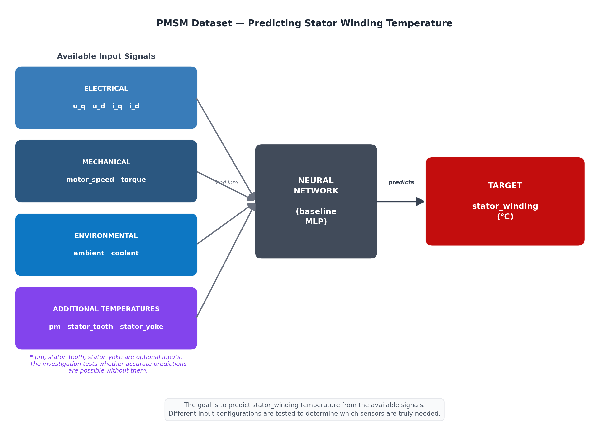
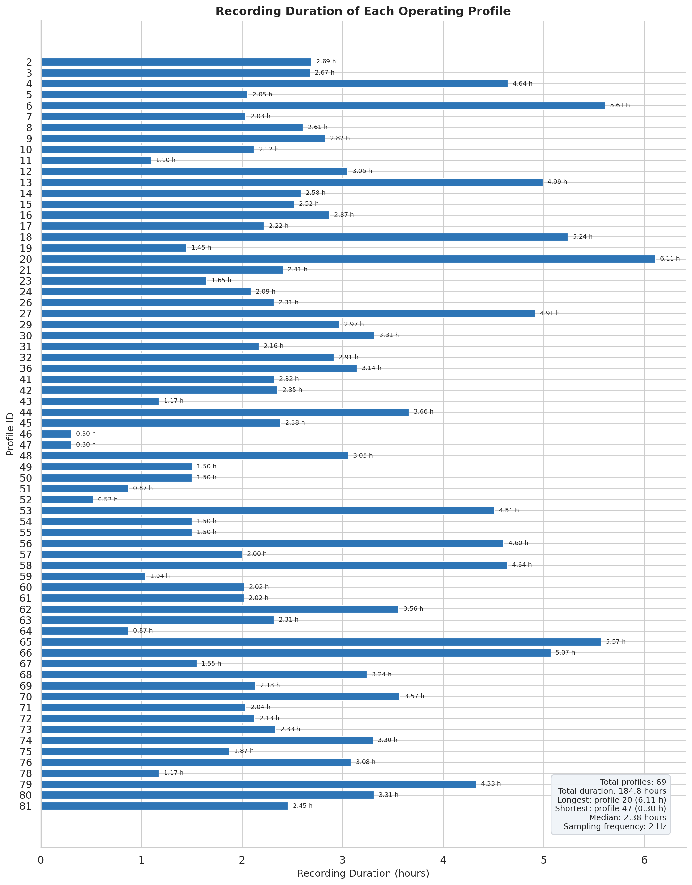
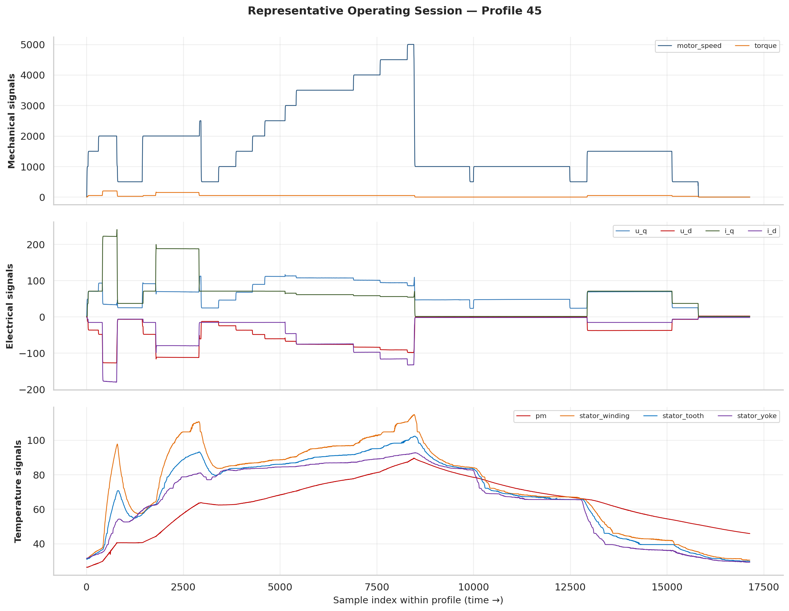
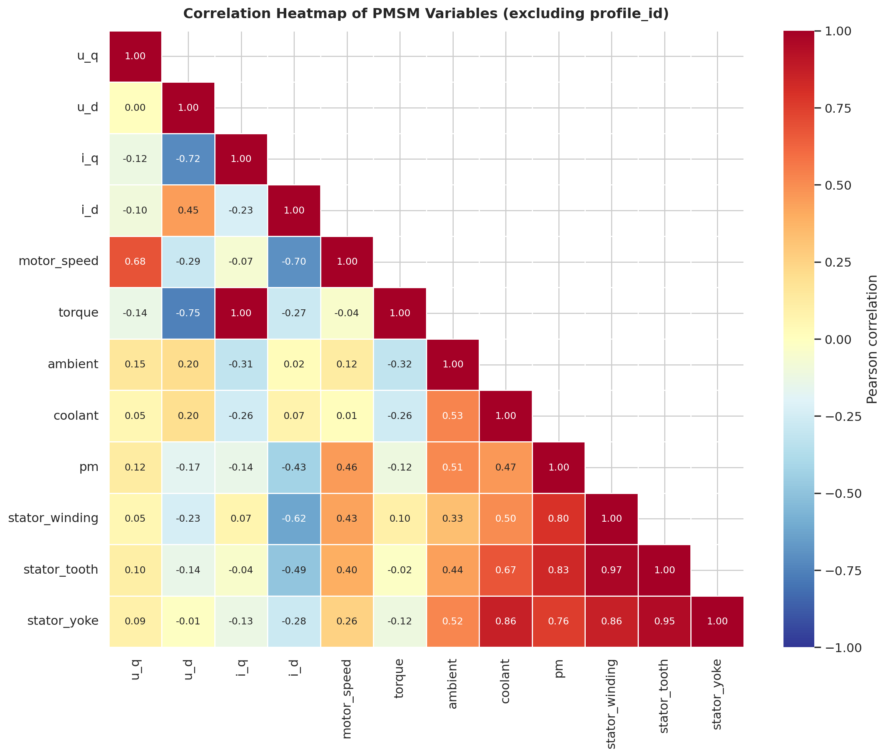
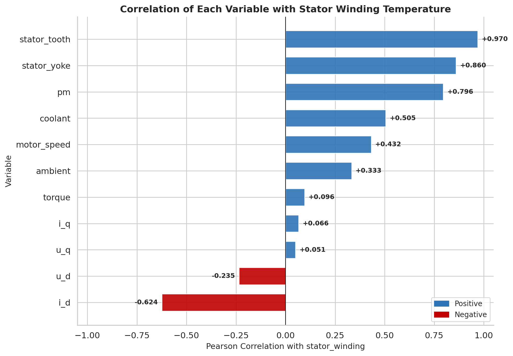
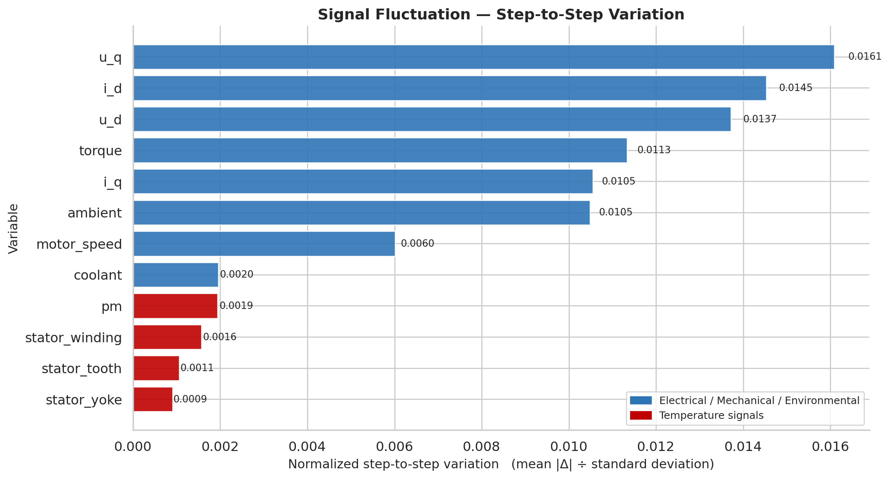

# PMSM Dataset Exploration

I explored the PMSM Electric Motor Temperature dataset to understand what it contains and
how the variables relate to each other before using it for the neural-network pruning
experiments. The goal is to predict **stator winding temperature** from the remaining
available signals.

I didn't know much about motor engineering when I started, so the notes below explain things
from scratch.

**Dataset:** [Kaggle — wkirgsn/electric-motor-temperature](https://www.kaggle.com/datasets/wkirgsn/electric-motor-temperature)
**File:** `measures_v2.csv` (~138 MB — download from Kaggle, place in `data/`)

---

## What a PMSM is

A PMSM (Permanent Magnet Synchronous Motor) is an electric motor commonly used in electric
vehicles and industrial drives. When it runs, it generates heat. If parts get too hot, the
permanent magnets can be permanently damaged. Measuring the internal temperatures directly is
expensive and difficult in production motors, so engineers want to predict them from signals
that are already available — voltages, currents, speed, coolant temperature, and so on.

Our task is to predict `stator_winding` — the temperature of the copper coils inside the
stator. This is the component that is hardest to instrument with a physical sensor.

---

## Variables

| Variable | What it measures | Category | Role |
|----------|-----------------|----------|------|
| `u_q` | q-axis voltage | Electrical | Input |
| `u_d` | d-axis voltage | Electrical | Input |
| `i_q` | q-axis current | Electrical | Input |
| `i_d` | d-axis current | Electrical | Input |
| `motor_speed` | Rotational speed (rpm) | Mechanical | Input |
| `torque` | Turning force (Nm) | Mechanical | Input |
| `ambient` | Air temperature around the bench | Environmental | Input |
| `coolant` | Coolant liquid temperature | Environmental | Input |
| `pm` | Permanent magnet temperature | Thermal | Input (optional) |
| `stator_tooth` | Stator tooth temperature | Thermal | Input (optional) |
| `stator_yoke` | Stator yoke temperature | Thermal | Input (optional) |
| `stator_winding` | Stator winding temperature | Thermal | **Target** |
| `profile_id` | Recording session label | Metadata | Grouping |

The optional temperature signals (pm, stator_tooth, stator_yoke) are other temperature
sensors inside the motor. Part of the investigation is to test whether accurate predictions
are possible without them — if so, those sensors would not be needed in production.

---

## Dataset size and sampling

| Property | Value |
|----------|-------|
| Total samples | 1,330,816 |
| Operating profiles | 69 |
| Sampling frequency | 2 Hz |
| Total duration | ~185 hours (~7.7 days) |
| Missing values | 0 |

The sampling frequency of 2 Hz means two measurements per second — one sample every
0.5 seconds. Duration in hours is calculated as: samples ÷ (2 × 3600).

---

## What `profile_id` means

The data was not recorded in one continuous run. Engineers ran the motor through 69 separate
test sessions, each with a different driving pattern. Every row is tagged with its session
number — that is `profile_id`.

It is just a bookkeeping label (not a physical measurement) and should never be used as a
model input. But it is essential for splitting: when creating train/test sets, we keep whole
profiles together. If rows from the same session appear on both sides, the model can
"cheat" because adjacent rows at 2 Hz are nearly identical.

---

## Figures

### 1. PMSM system overview



**What it shows:** The available signals grouped by category, feeding into a neural network
that predicts stator_winding temperature.

**Why it matters:** This is the core picture of the task. Different baseline configurations
use different subsets of these signals to see which ones are actually needed.

**Observation:** The optional temperature signals (pm, stator_tooth, stator_yoke) are shown
separately because the investigation tests whether prediction works without them.

---

### 2. Recording duration of each operating profile



**What it shows:** How long each of the 69 sessions lasted, in hours.

**Why it matters:** Sessions range from about 18 minutes (profile 47) to over 6 hours
(profile 20), with a median of about 2.4 hours. This large variation is why we split by
whole profiles rather than by individual rows — a random row-level split would leak
information from the longer sessions.

**Observation:** A handful of profiles are much longer than the rest. These dominate the
dataset in terms of sample count, so profile-based splitting ensures the model is tested on
genuinely unseen operating conditions.

---

### 3. Representative operating session



**What it shows:** How the measured signals evolve during one representative session.
Mechanical and electrical signals are shown in the top two panels; temperature signals in the
bottom panel.

**Why it matters:** This is the best single figure for understanding the dataset. It shows
the relationship between driving conditions and temperature response — electrical and
mechanical signals vary rapidly as the operating point changes, while temperatures respond
more gradually because of thermal inertia.

**Observation:** When the motor runs at high speed or high torque, temperatures rise. When
the load drops, temperatures slowly decay. The delay between cause (load change) and effect
(temperature change) is clearly visible.

---

### 4. Correlation heatmap



**What it shows:** Pearson correlation between every pair of variables. Values near +1 mean
they rise and fall together; near −1 means one rises when the other falls; near 0 means no
linear relationship.

**Why it matters:** It shows at a glance which signals are related and how the temperature
variables relate to each other.

**Observation:** The three stator temperatures (winding, tooth, yoke) are very highly
correlated with each other (r > 0.85) — they heat up almost together. Among the
non-temperature signals, coolant and motor_speed have the clearest links to stator_winding.

---

### 5. Correlation with stator_winding



**What it shows:** How strongly each variable correlates with stator_winding, ranked from
strongest to weakest.

**Why it matters:** This directly shows which signals carry the most information about our
prediction target.

**Observation:** stator_tooth (r = +0.97), stator_yoke (r = +0.86), and pm (r = +0.80) are
the strongest — but using them as inputs partly defeats the purpose of a virtual sensor.
Among the non-temperature signals, coolant (r = +0.51), motor_speed (r = +0.43), and i_d
(r = −0.62) show the most useful relationships.

---

### 6. Signal fluctuation (step-to-step variation)



**What it shows:** How much each signal changes from one timestep to the next. This is
measured as the average absolute step change divided by the signal's standard deviation, so
all variables are comparable regardless of their units. Larger values mean the signal changes
more rapidly; smaller values mean it changes more gradually.

**Why it matters:** It tells us about the nature of each signal — whether it reacts quickly
to changes in operating conditions or evolves slowly.

**Observation:** Electrical and mechanical signals (u_q, i_d, u_d, torque) fluctuate the
most. Temperature signals (pm, stator_winding, stator_tooth, stator_yoke) are the smoothest,
which makes sense — temperatures are governed by thermal inertia and change gradually.

---

## How to run

```bash
pip install pandas numpy matplotlib seaborn
mkdir -p data
# download measures_v2.csv from Kaggle and place it in data/

python dataset_understanding_report.py
# or open dataset_exploration.ipynb (renders on GitHub without running)
```

---

## Repository layout

```
.
├── dataset_exploration.ipynb           # notebook (renders on GitHub)
├── dataset_understanding_report.py     # generates all plots and prints explanations
├── README_dataset_understanding.md     # this file
├── .gitignore
├── data/
│   ├── README.txt
│   └── measures_v2.csv                 # download from Kaggle (git-ignored)
└── plots/
    ├── pmsm_system_flow.png
    ├── profile_durations.png
    ├── causal_timeline_profile.png
    ├── correlation_heatmap.png
    ├── correlation_with_stator_winding.png
    └── bumpiness_analysis.png
```

---

## What I would explain in the meeting

- The dataset contains about 1.33 million measurements from 69 separate motor test sessions,
  sampled at 2 Hz (two measurements per second), covering roughly 185 hours of operation.
- Each session has a `profile_id`. When splitting into train and test sets, we keep whole
  profiles together to avoid leaking information between adjacent samples.
- Sessions range from 18 minutes to 6 hours, so profile-based splitting is important —
  a random row-level split would let the model exploit the similarity between neighbouring
  rows within a session.
- The prediction target is `stator_winding` — the temperature of the copper coils, which is
  hard to instrument with a physical sensor in a production motor.
- The strongest predictors are other temperature sensors (stator_tooth r = 0.97, stator_yoke
  r = 0.86, pm r = 0.80), but using them defeats the purpose of a virtual sensor. Among the
  non-temperature signals, coolant (r = 0.51) and motor_speed (r = 0.43) are the most useful.
- The signal fluctuation analysis shows that electrical and mechanical signals change rapidly
  from one timestep to the next, while temperatures change gradually — the neural network
  needs to learn a smoothing relationship, not just copy signals through.
